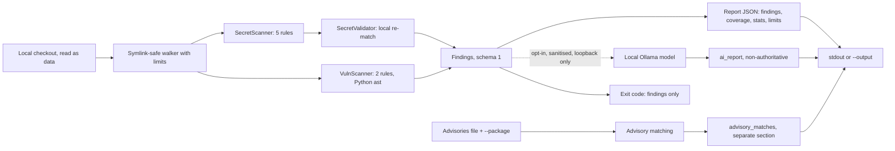
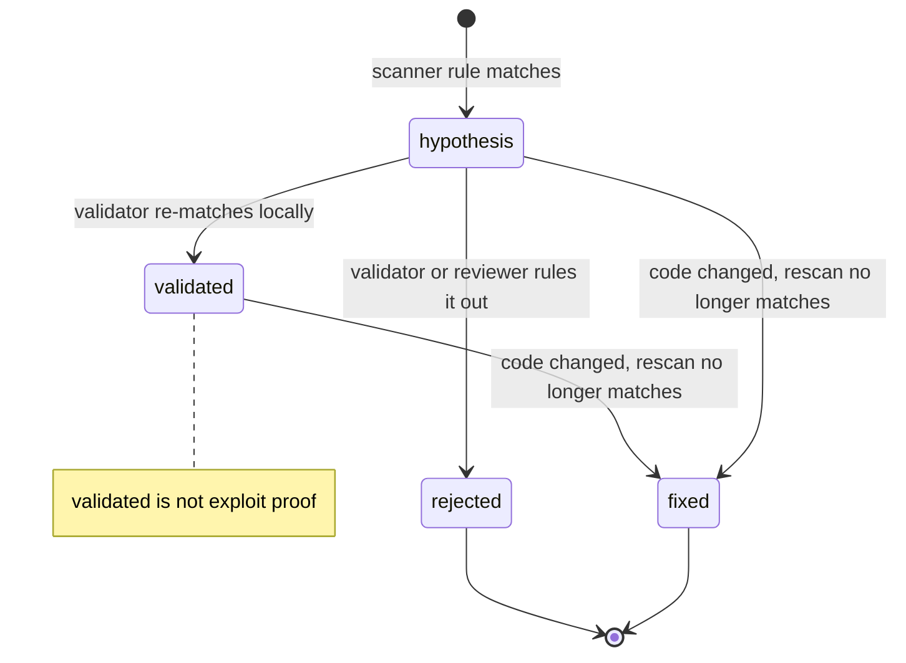

# security-reviewer

Open-source AI security reviewer that detects, validates, explains, and
prioritizes vulnerabilities in GitHub repositories. The core is a static,
offline, standard-library-only scanner. AI is optional, local-only and never
authoritative.

- Scope today: Python source for **2 vulnerability rules**, plus **5 secret
  rules** on any text file. A clean report is not a safety statement.
- Docs: [getting started](docs/getting-started.md) |
  [interpreting results](docs/interpreting-results.md) |
  [CLI](docs/cli.md) | [scanner](docs/scanner.md) |
  [detectors](docs/detectors.md) | [finding format](docs/finding-format.md) |
  [benchmark](docs/benchmark.md) | [local AI report](docs/local-report.md)

## Install (clean checkout)

Requires Python 3.10 or newer. There are no third-party dependencies.

```
git clone <URL-of-this-repository> security-reviewer
cd security-reviewer
python3 -m venv .venv
. .venv/bin/activate
pip install .
security-reviewer review examples/demo --timestamp 2026-01-02T03:04:05Z
```

Without installing, run it straight from the checkout:

```
PYTHONPATH=src python3 -m security_reviewer review examples/demo --timestamp 2026-01-02T03:04:05Z
```

## Example

`examples/demo/` is a tiny synthetic fixture: `join_vuln.py` and
`tar_vuln.py` trigger the two vulnerability rules and `settings.py` holds a
made-up placeholder-style password (not a credential). Running the command
above prints one JSON report (exit code 0); the complete output is checked in
as [examples/expected/review.json](examples/expected/review.json). Its
findings, abbreviated:

| Finding id | Rule | Where | Severity | Confidence | Status |
| --- | --- | --- | --- | --- | --- |
| `vuln.path-join-absolute-check-incomplete.313723afc31bd1e7` | `path-join-absolute-check-incomplete` | `join_vuln.py:13` | medium | medium | hypothesis |
| `secret.generic-credential.10720fd687a4fc0a` | `generic-credential` | `settings.py:2` | medium | low | validated |
| `vuln.tar-symlink-target-unchecked.9d0038aeaf0badc2` | `tar-symlink-target-unchecked` | `tar_vuln.py:9` | high | medium | hypothesis |

The secret finding, verbatim (the value never appears, only the text before
it followed by `[REDACTED]`):

```json
{
  "evidence": [
    {
      "kind": "tool_output",
      "summary": "Rule generic-credential matched at line 2; secret value redacted."
    },
    {
      "kind": "code_snippet",
      "snippet": "password = \"[REDACTED]",
      "summary": "Text before the match; the rest is redacted."
    }
  ],
  "id": "secret.generic-credential.10720fd687a4fc0a",
  "status": "validated",
  "validation": {
    "method": "tool_confirmed",
    "notes": "Pattern re-matched at the recorded location; this does not prove the credential is live.",
    "validated_at": "2026-01-02T03:04:05Z",
    "validated_by": "security_reviewer.SecretValidator"
  }
}
```

With `--fail-on-findings` the same command exits 1. Add
`--advisories examples/demo/advisories.json --package demo-pkg=1.0` to get a
separate `advisory_matches` section
([examples/expected/review-advisory.json](examples/expected/review-advisory.json));
it never changes `findings`.

Re-running with the same options gives byte-identical output:

```
security-reviewer review examples/demo --timestamp 2026-01-02T03:04:05Z --output /tmp/a.json
security-reviewer review examples/demo --timestamp 2026-01-02T03:04:05Z --output /tmp/b.json
cmp /tmp/a.json /tmp/b.json && cmp /tmp/a.json examples/expected/review.json && echo identical
```

## Reading the result

See [docs/interpreting-results.md](docs/interpreting-results.md) for the
details. In short:

- **Severity** (`high`/`medium`/`low`) is the potential impact if the
  finding is real; **confidence** is how sure the rule is that this is a real
  instance. Neither is a probability of exploitation.
- **Status** `hypothesis` means a rule matched. `validated` means the
  pattern was re-matched locally at the recorded location
  (`tool_confirmed`). It is **not** exploit proof and, for secrets, not
  proof that a credential is live.
- Exit codes: `0` success, `1` findings with `--fail-on-findings`, `2` usage
  or input error.

## Architecture



## Finding lifecycle



Advisory matching is a separate path: it compares a declared package
version with an advisory range and reports `affected`, `patched` or
`not_affected` in `advisory_matches`. It does not create, change or remove
findings. The `ai_report` is generated text on top of the findings; it is
non-authoritative and cannot affect findings or the exit code. The current
CLI itself only moves findings from `hypothesis` to `validated`; `rejected`
and `fixed` are recorded states in the
[finding format](docs/finding-format.md) set by later review or a rescan.

## Supported scope and known limits

- Rules (5 secret): `aws-access-key-id`, `private-key`, `github-token`,
  `slack-token`, `generic-credential`. Rules (2 vulnerability):
  `path-join-absolute-check-incomplete`, `tar-symlink-target-unchecked`
  (both CWE-22, Python source only). See [docs/scanner.md](docs/scanner.md)
  and [docs/detectors.md](docs/detectors.md).
- Two vulnerability rules only. A clean report is not a statement that the
  code is safe.
- Always read the `coverage` block: unparsed Python, other-language files,
  skipped files and hit caps are not analysed.
- Working tree only: no git history and no blob scanning.
- No temporary `ASIA` AWS keys; placeholder-shaped values are ignored.
- No dependency resolution: package versions come only from `--package`.
- Findings are hypotheses; there is no exploit reproduction.

## Handling potential secrets safely

- Output is redacted, but the redaction is best effort; treat reports as
  sensitive and keep them private.
- If a finding is a real credential, rotate or revoke it at the issuer first,
  then remove it from the source and history.
- Never test or "verify" a found credential against its provider. This tool
  does not, and you should not.
- Do not commit report files produced from real repositories. Only the
  synthetic examples in `examples/` belong in this repository.

## Benchmark and local AI report

Reproduce the scoring harness on a tiny synthetic benchmark with
[docs/benchmark.md](docs/benchmark.md). Third-party snapshots, the held-out
split, private findings and scoring labels live outside this repository and
must not be committed. The optional local model summary (loopback Ollama,
nothing leaves the machine) is described in
[docs/local-report.md](docs/local-report.md).

## Tests

```
python3 -m unittest discover -s tests -t .
```
