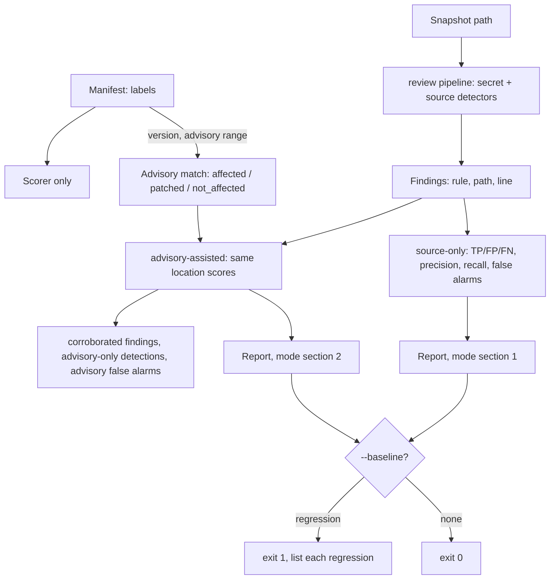

# Benchmark harness

```
security-reviewer benchmark MANIFEST --root BENCH_ROOT
    [--split dev|heldout|all] [--mode source-only|advisory-assisted|both]
    [--baseline FILE] [--write-baseline FILE] [--output FILE] [--deterministic]
```

The harness scores the detectors on labelled snapshots, in two separately
reported modes that are never blended.



## Manifest (JSON, schema 1)

Per case: `id`, `split` (`dev` or `heldout`), `role` (`vulnerable`, `fixed`,
`control`, `lookalike`), `snapshot` (path relative to `--root`, no `..`, not a
symlink), `expected` (list of `{rule, path, line}`; non-empty only for
`vulnerable`), and optionally `advisory` (`id`, `affected`, `fixed`, `cwe`),
`package` (or `product`), `version`, `ecosystem`, `commit`. Only the scorer
reads labels; the scanner receives the snapshot directory and nothing else.
`--split` defaults to `dev`: held-out cases are scored only when asked for, so
detectors are tuned on `dev` alone.

## Scoring

A finding matches an expected entry iff the rule and path are equal and the
line differs by at most 2. Per case: `tp` = expected entries matched by at
least one finding, `fn` = unmatched entries, `fp` = findings matching no
expected entry (all findings on non-vulnerable cases are false alarms).
Reported per mode: totals, precision and recall (`null` when undefined),
false alarms by role (`fixed`, `lookalike`, `control`), per-case results,
unsupported-file counts and per-case `runtime_ms`.

`source-only` uses the findings alone. `advisory-assisted` has identical
location scores by construction (advisory data never changes findings), plus
an `advisory` block: for cases whose advisory range contains the case version
the match is recorded and findings with the advisory's CWE are
`corroborated`; `advisory_only_detections` counts in-range vulnerable cases
the source detectors missed (still false negatives in the location score);
`advisory_false_alarms` counts in-range non-vulnerable cases.

## Baseline and exit codes

`--write-baseline FILE` stores per-mode counts and per-case expectations
(no runtimes) and is the only way a baseline changes. `--baseline FILE`
compares with zero tolerance and exits 1, listing each regression, if recall,
precision, any case's TP, or any fixed/lookalike/control case's false
positives got worse, `detector_skipped` or `detector_errors` increased, a
new `source_scan_caps_hit` key appeared (all per case and mode), a baseline case is missing or changed role, or any
baseline expectation was removed or edited (weakening expectations is itself a
regression). Improvements pass but are not recorded. If `--baseline` and
`--write-baseline` are combined and a regression exists, nothing is written.
The baseline must match `--split` and contain the requested modes.

| Code | Meaning |
| --- | --- |
| 0 | OK |
| 1 | Regression versus the baseline; or, without `--baseline`, a missed expected finding or a finding on a non-vulnerable case |
| 2 | Usage error: bad manifest, root, snapshot path or baseline |

`--deterministic` omits `runtime_ms`; the report has no other time data, so
two runs are byte-identical. Runtimes are excluded from baselines either way.

## Rerun the synthetic example

`examples/benchmark/` is a tiny synthetic benchmark: `manifest.json` (5 cases,
all `dev` split) and invented snapshots under `snapshots/`. It contains no
real project code and no real findings. Run from the repository root (use
`PYTHONPATH=src python3 -m security_reviewer` instead of `security-reviewer`
if you did not `pip install .`):

```
M="examples/benchmark/manifest.json --root examples/benchmark"
T=$(mktemp -d)    # scratch directory outside the repository

# source-only: detector findings only
security-reviewer benchmark $M --mode source-only --deterministic

# advisory-assisted: same location scores plus the advisory block
security-reviewer benchmark $M --mode advisory-assisted --deterministic

# both modes, reported in separate sections (the default)
security-reviewer benchmark $M --mode both --deterministic

# write a baseline (explicit, the only way a baseline changes), then compare
security-reviewer benchmark $M --deterministic --write-baseline $T/baseline.json
security-reviewer benchmark $M --deterministic --baseline $T/baseline.json; echo $?   # 0

# reproducibility: run twice and compare byte for byte
security-reviewer benchmark $M --deterministic --output $T/a.json
security-reviewer benchmark $M --deterministic --output $T/b.json
cmp $T/a.json $T/b.json && echo identical
```

Checked-in outputs: [both](../examples/expected/benchmark-both.json),
[source-only](../examples/expected/benchmark-source-only.json),
[advisory-assisted](../examples/expected/benchmark-advisory-assisted.json).
Do not commit a baseline you create for private data. Note that a
`--baseline` run adds a `regressions` list to the report and omits
`failed_expectations`, so it is not byte-identical to a run without
`--baseline`.

Real output, abbreviated to the totals (the same in both modes):

```json
"overall": {
  "fn": 0,
  "fp": 0,
  "precision": 1.0,
  "recall": 1.0,
  "tp": 2
}
```

and the `advisory` block that only the advisory-assisted section has:

```json
"advisory": {
  "advisory_false_alarms": 0,
  "advisory_only_detections": 0,
  "cases_with_advisory": 2,
  "corroborated_fp": 0,
  "corroborated_tp": 1,
  "in_range_cases": 1,
  "uncorroborated_tp": 0
}
```

Both runs exit 0. Perfect scores on this fixture only show the harness works;
they say nothing about detector quality on real code.

## Interpreting source-only versus advisory-assisted

- `source-only` is the measurement of the detectors: what they found,
  missed, and falsely alarmed on.
- `advisory-assisted` has the identical location scores, because advisory
  matching never changes findings. Its extra `advisory` block says how the
  declared version and advisory range relate to those findings (for example
  `corroborated_tp`: a true positive whose CWE matches an in-range advisory;
  `advisory_only_detections`: in-range vulnerable cases the detectors missed,
  which are still false negatives).
- The two sections are never blended into one score, so a good advisory
  match cannot hide a detector miss. Compare detector changes in
  `source-only`; read the advisory block as corroboration only.

## What stays out of the repository

Third-party source snapshots, the held-out split, private findings and
scoring labels live outside this repository, in private state, and must not
be committed. Examples in the repository are synthetic: no real project
snapshots and no real findings. Tune only on `dev`.

## Private/public split

The repository holds the harness and small synthetic test fixtures only.
Labels (manifests), real snapshots, the held-out split and baselines tied to
them stay outside the repository (for example under a private data directory)
and are passed by path. Do not commit them.

## Limitations

- Location-level matching with a +/-2 line tolerance; one-to-one matching of
  duplicate findings is not enforced.
- The dev set is tiny (a vulnerable/fixed pair per rule); a perfect dev score
  is expected because the rules were tuned on it. Use the held-out split for
  an honest estimate and never tune on it.
- Secret rules also run, so a secret false alarm in a snapshot counts against
  it.
- Scores depend on the scanner's limits and skip rules (see `coverage`).
