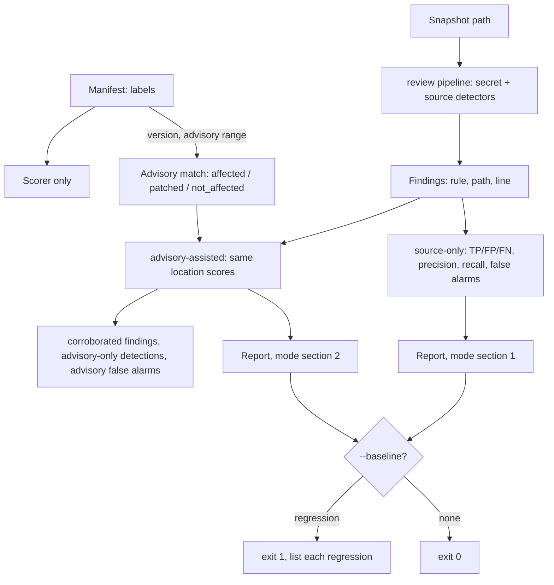

# Benchmark harness

```
security-reviewer benchmark MANIFEST --root BENCH_ROOT
    [--split dev|heldout|all] [--mode source-only|advisory-assisted|both]
    [--baseline FILE] [--write-baseline FILE] [--output FILE] [--deterministic]
```

The harness scores the detectors on labelled snapshots, in two separately
reported modes that are never blended.



## Manifest (JSON, schema 1)

Per case: `id`, `split` (`dev` or `heldout`), `role` (`vulnerable`, `fixed`,
`control`, `lookalike`), `snapshot` (path relative to `--root`, no `..`, not a
symlink), `expected` (list of `{rule, path, line}`; non-empty only for
`vulnerable`), and optionally `advisory` (`id`, `affected`, `fixed`, `cwe`),
`package` (or `product`), `version`, `ecosystem`, `commit`. Only the scorer
reads labels; the scanner receives the snapshot directory and nothing else.
`--split` defaults to `dev`: held-out cases are scored only when asked for, so
detectors are tuned on `dev` alone.

## Scoring

A finding matches an expected entry iff the rule and path are equal and the
line differs by at most 2. Per case: `tp` = expected entries matched by at
least one finding, `fn` = unmatched entries, `fp` = findings matching no
expected entry (all findings on non-vulnerable cases are false alarms).
Reported per mode: totals, precision and recall (`null` when undefined),
false alarms by role (`fixed`, `lookalike`, `control`), per-case results,
unsupported-file counts and per-case `runtime_ms`.

`source-only` uses the findings alone. `advisory-assisted` has identical
location scores by construction (advisory data never changes findings), plus
an `advisory` block: for cases whose advisory range contains the case version
the match is recorded and findings with the advisory's CWE are
`corroborated`; `advisory_only_detections` counts in-range vulnerable cases
the source detectors missed (still false negatives in the location score);
`advisory_false_alarms` counts in-range non-vulnerable cases.

## Baseline and exit codes

`--write-baseline FILE` stores per-mode counts and per-case expectations
(no runtimes) and is the only way a baseline changes. `--baseline FILE`
compares with zero tolerance and exits 1, listing each regression, if recall,
precision, any case's TP, or any fixed/lookalike/control case's false
positives got worse, a baseline case is missing or changed role, or any
baseline expectation was removed or edited (weakening expectations is itself a
regression). Improvements pass but are not recorded. If `--baseline` and
`--write-baseline` are combined and a regression exists, nothing is written.
The baseline must match `--split` and contain the requested modes.

| Code | Meaning |
| --- | --- |
| 0 | OK |
| 1 | Regression versus the baseline; or, without `--baseline`, a missed expected finding or a finding on a non-vulnerable case |
| 2 | Usage error: bad manifest, root, snapshot path or baseline |

`--deterministic` omits `runtime_ms`; the report has no other time data, so
two runs are byte-identical. Runtimes are excluded from baselines either way.

## Private/public split

The repository holds the harness and small synthetic test fixtures only.
Labels (manifests), real snapshots, the held-out split and baselines tied to
them stay outside the repository (for example under a private data directory)
and are passed by path. Do not commit them.

## Limitations

- Location-level matching with a +/-2 line tolerance; one-to-one matching of
  duplicate findings is not enforced.
- The dev set is tiny (a vulnerable/fixed pair per rule); a perfect dev score
  is expected because the rules were tuned on it. Use the held-out split for
  an honest estimate and never tune on it.
- Secret rules also run, so a secret false alarm in a snapshot counts against
  it.
- Scores depend on the scanner's limits and skip rules (see `coverage`).
