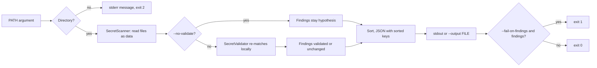

# Command-line interface

`security-reviewer review` runs the local `SecretScanner`, `SecretValidator`
and the source-based `VulnScanner` (see [detectors.md](detectors.md))
against a checkout directory and prints one redacted JSON report. The
`benchmark` subcommand is described in [benchmark.md](benchmark.md). It is
static and defensive only: files are read as data, never executed, and no
live credential testing is performed.

## Offline and data flow

By default nothing is sent to any model provider or network. The CLI uses
only the Python standard library, opens no sockets, and spawns no processes.
The only exception is the explicit opt-in `--ai-report`, which talks to a
model on a loopback address; see [local-report.md](local-report.md). Secret
values are redacted by the scanner before they reach any output.



## Install and run

```
PYTHONPATH=src python3 -m security_reviewer review PATH
pip install .            # provides the `security-reviewer` command
security-reviewer review PATH
```

## Options

| Option | Meaning |
| --- | --- |
| `--no-vuln` | Do not run the source vulnerability detectors. |
| `--no-secrets` | Do not run the secret scanner (not both at once). |
| `--advisories FILE` | Local JSON list of advisories (`id`, `package`, `affected`, optional `fixed`, `cwe`); see below. |
| `--package NAME=VERSION` | Declared package version to match against `--advisories`; repeatable. |
| `--no-validate` | Skip the validator; findings stay `hypothesis`. |
| `--output FILE` | Write the report to FILE instead of stdout. |
| `--fail-on-findings` | Exit 1 if any finding is reported. |
| `--timestamp ISO` | `validated_at` value, e.g. `2026-01-02T03:04:05Z`. |
| `--ai-report` | Opt in to a local-model summary in a top-level `ai_report` key (loopback Ollama only); see [local-report.md](local-report.md). |
| `--ai-model`, `--ai-endpoint`, `--ai-timeout`, `--ai-num-ctx`, `--ai-max-tokens` | Settings for `--ai-report` (defaults `qwen3:4b`, `http://127.0.0.1:11434`, 120, 4096, 1024); usage error without `--ai-report`. |
| `--max-file-size`, `--max-files`, `--max-total-bytes`, `--max-findings`, `--max-line-length`, `--max-entries`, `--max-depth` | Scanner limits (positive integers). |

The validation timestamp is deterministic: `--timestamp` if given, else
`SOURCE_DATE_EPOCH` if set, else the fixed placeholder
`1970-01-01T00:00:00Z`. The report contains no other time or host data.

## Output

A single JSON object (sorted keys, 2-space indent, ASCII, trailing newline):

- `schema_version`: report version (1); `finding_schema_version`: format of
  each finding (see [finding-format.md](finding-format.md)).
- `tool`: `"security-reviewer"`.
- `root`: always `"."`; finding paths are relative to PATH, so absolute
  paths are never leaked.
- `validated`: whether the validator ran.
- `findings`: `Finding.to_dict()` objects sorted by path, line, column, id.
- `findings` hold secret (`secret.<rule>.<hash>`) and vulnerability
  (`vuln.<rule>.<hash>`) findings together, told apart by rule id.
- `coverage`: `rules_run` (`secret` and `vulnerability` rule ids),
  `source_detectors_ran`, `files_seen` (per language), `files_parsed`, and
  `unsupported` (`unparseable` Python files, `unsupported_language` files).
  `detector_errors` (files where a detector aborted) and `detector_skipped`
  (functions skipped because they exceeded the per-function or per-file work
  cap) also count as unanalysed. `source_scan_caps_hit` repeats the
  walker cap flags (entries, depth, files, bytes, findings) of the source
  detector pass.
  A clean result means "nothing found in what was analysed"; check it.
- `--max-findings` applies to each scanner separately (secrets, then source
  detectors), so the report can hold up to twice that many findings.
- `--package` requires `--advisories` (usage error otherwise).
- `advisory_matches`: always present, separate from `findings`. One record
  per (advisory, `--package`) pair whose package names match (PEP 503
  normalised), with `status` `affected`, `patched` or `not_affected`.
  It never adds, removes or changes a finding or exit code.
- `ai_report`: present only with `--ai-report`; non-authoritative, never
  affects findings or the exit code (see [local-report.md](local-report.md)).
- `stats`: scanner counters (files scanned, skip counts, cap flags). Skip
  sample paths are omitted.
- `limits`: the effective scanner limits.

Advisory ranges use `<=`, `<`, `>=`, `>`, `==`, `!=` joined by commas (AND),
over a PEP 440-style version order (pre, post, dev, epoch; local part
ignored). A malformed advisory file, range or `--package` is a usage error.

Two runs on the same input with the same options are byte-identical.

## Exit codes

| Code | Meaning |
| --- | --- |
| 0 | Success (findings may exist unless `--fail-on-findings`). |
| 1 | Findings present and `--fail-on-findings` given. |
| 2 | Usage error, bad flag value, PATH missing/not a directory/not readable and searchable (message `cannot read PATH`), unwritable `--output`, `--ai-*` without `--ai-report` or an endpoint that is not a loopback `http` URL, invalid `SOURCE_DATE_EPOCH` (must be an integer 0 to 253402300799), or stdout closed early (broken pipe, silent). A one-line message goes to stderr, never file contents. |

Partial unreadability is not an error: if PATH itself is readable but some
files or subdirectories are not, they are skipped, counted in
`stats.skipped_unreadable`, and the exit code is unaffected (0, or 1 with
`--fail-on-findings` and findings). Check that counter when completeness
matters.

## Reproducible review steps

1. Check out the exact commit to a local directory.
2. `security-reviewer review CHECKOUT --output report.json --timestamp 2026-01-02T03:04:05Z`
3. Re-run and compare (`cmp`) to confirm identical output.
4. Treat `validated` as "pattern re-matched locally", not proof a
   credential is live; rotate any real secret found.
