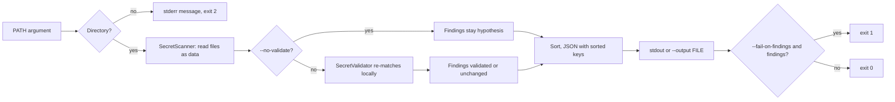

# Command-line interface

`security-reviewer` runs the local `SecretScanner` and `SecretValidator`
against a checkout directory and prints one redacted JSON report. It is
static and defensive only: files are read as data, never executed, and no
live credential testing is performed.

## Offline and data flow

Nothing is sent to any model provider or network. The CLI uses only the
Python standard library, opens no sockets, and spawns no processes. Secret
values are redacted by the scanner before they reach any output.



## Install and run

```
PYTHONPATH=src python3 -m security_reviewer review PATH
pip install .            # provides the `security-reviewer` command
security-reviewer review PATH
```

## Options

| Option | Meaning |
| --- | --- |
| `--no-validate` | Skip the validator; findings stay `hypothesis`. |
| `--output FILE` | Write the report to FILE instead of stdout. |
| `--fail-on-findings` | Exit 1 if any finding is reported. |
| `--timestamp ISO` | `validated_at` value, e.g. `2026-01-02T03:04:05Z`. |
| `--max-file-size`, `--max-files`, `--max-total-bytes`, `--max-findings`, `--max-line-length`, `--max-entries`, `--max-depth` | Scanner limits (positive integers). |

The validation timestamp is deterministic: `--timestamp` if given, else
`SOURCE_DATE_EPOCH` if set, else the fixed placeholder
`1970-01-01T00:00:00Z`. The report contains no other time or host data.

## Output

A single JSON object (sorted keys, 2-space indent, ASCII, trailing newline):

- `schema_version`: report version (1); `finding_schema_version`: format of
  each finding (see [finding-format.md](finding-format.md)).
- `tool`: `"security-reviewer"`.
- `root`: always `"."`; finding paths are relative to PATH, so absolute
  paths are never leaked.
- `validated`: whether the validator ran.
- `findings`: `Finding.to_dict()` objects sorted by path, line, column, id.
- `stats`: scanner counters (files scanned, skip counts, cap flags). Skip
  sample paths are omitted.
- `limits`: the effective scanner limits.

Two runs on the same input with the same options are byte-identical.

## Exit codes

| Code | Meaning |
| --- | --- |
| 0 | Success (findings may exist unless `--fail-on-findings`). |
| 1 | Findings present and `--fail-on-findings` given. |
| 2 | Usage error, bad flag value, PATH missing/not a directory/unreadable, or unwritable `--output`. A one-line message goes to stderr, never file contents. |

## Reproducible review steps

1. Check out the exact commit to a local directory.
2. `security-reviewer review CHECKOUT --output report.json --timestamp 2026-01-02T03:04:05Z`
3. Re-run and compare (`cmp`) to confirm identical output.
4. Treat `validated` as "pattern re-matched locally", not proof a
   credential is live; rotate any real secret found.
