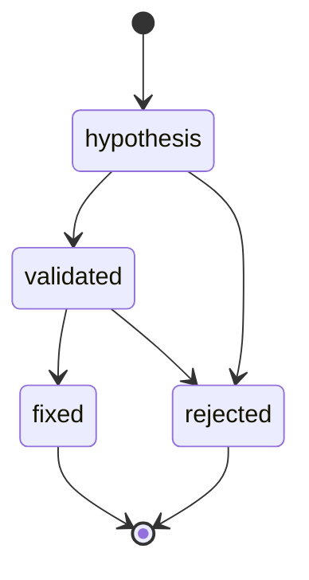

# Finding format (schema_version "1")

A finding is a single JSON object describing one potential or confirmed
security issue. Implementation: `src/security_reviewer/finding.py`
(stdlib-only Python 3.12).

Finding generation is independent of GitHub and of any model provider. The
format only records where a finding came from (`origin`); it does not depend on
any API, hosting service or model vendor.

## Version policy

`schema_version` is the string `"1"`. Any breaking change (removing or renaming
a field, tightening a rule, changing an enum value or its meaning) bumps
`schema_version`. Additive, optional fields also require a bump because parsing
is strict: unknown keys are rejected everywhere. Parsers reject any version
other than the one they implement.

## Finding fields

| Field | Type | Rules |
|---|---|---|
| `schema_version` | string | required, must be exactly `"1"` |
| `id` | string | required, `^[A-Za-z0-9][A-Za-z0-9._-]{0,63}$` |
| `title` | string | required, 1-200 chars, single line (no control characters, newlines or line separators) |
| `category` | string | required, 1-100 chars, single line |
| `cwe` | string | optional, `^CWE-[0-9]+$` (ASCII digits only) |
| `severity` | enum | `critical`, `high`, `medium`, `low`, `info` |
| `confidence` | enum | `high`, `medium`, `low` |
| `status` | enum | `hypothesis`, `validated`, `rejected`, `fixed` |
| `origin` | enum | `static_tool`, `ai`, `human` |
| `locations` | array | required, at least one Location |
| `evidence` | array | required (may be empty), at most 50 Evidence items |
| `remediation` | object | required, Remediation |
| `validation` | object or null | Validation; may be omitted or null |
| `description` | string | optional, at most 5000 chars |

### Location

| Field | Rules |
|---|---|
| `path` | required; repo-relative POSIX path: non-empty, not absolute, no empty segment (`a//b`, trailing `/`), no `.` or `..` segment, no backslash, no control characters (U+0000-U+001F, U+007F) |
| `start_line` | required integer >= 1 (booleans rejected) |
| `end_line` | optional integer >= `start_line`; defaults to `start_line` |
| `start_column`, `end_column` | optional integers >= 1 |

### Evidence

| Field | Rules |
|---|---|
| `kind` | `code_snippet`, `tool_output`, `reproduction`, `model_reasoning` |
| `summary` | required, non-empty, at most 2000 chars |
| `snippet` | optional, at most 4000 chars |

### Remediation

| Field | Rules |
|---|---|
| `summary` | required, 1-2000 chars |
| `patch` | optional string, at most 20000 chars |
| `references` | optional list of at most 20 `http://` or `https://` URLs (each at most 2048 chars, no whitespace or control characters) |

### Validation

| Field | Rules |
|---|---|
| `method` | `tool_confirmed`, `exploit_reproduced`, `human_review` |
| `validated_by` | required, 1-200 chars, single line |
| `validated_at` | RFC3339 UTC timestamp ending in `Z`, e.g. `2026-01-02T03:04:05Z` (ASCII digits only) |
| `notes` | optional string, at most 5000 chars |

## Cross-field rules

- `validated` and `fixed`: need a `validation` and at least one evidence item
  whose kind is not `model_reasoning`. (`fixed` has the same requirements as
  `validated`.)
- `rejected`: needs a `validation` with `notes` that are non-blank after
  stripping whitespace.
- `hypothesis`: `validation` must be null/absent and `confidence` must not be
  `high`; a `critical` hypothesis needs at least one evidence item.

## Parsing and serialization

Parsing is strict: unknown keys are rejected, there is no type coercion, and
all errors are collected as `path: message` strings in
`ValidationError.errors` (`ValidationError` subclasses `ValueError`). Invalid
JSON, a non-object document, input larger than 1 MiB (1048576 bytes), or JSON
nested too deeply to parse also raises `ValidationError`.

All patterns (`id`, `cwe`, timestamp, URL) are matched against the whole string
(a trailing newline is rejected) and accept ASCII digits only.

Single-line fields (`title`, `category`, `validated_by`) reject every control
character (U+0000-U+001F, U+007F-U+009F) and the line/paragraph separators
U+2028 and U+2029.

Serialization (`to_json`) is deterministic: sorted keys, 2-space indent, `None`
values omitted, enums written as lowercase strings, trailing newline.

## Lifecycle



`Finding.transition(new_status, validation=None)` returns a new instance,
re-validates all rules, and rejects illegal moves. `validation` must be a
`Validation` instance or `None`, otherwise `ValidationError` is raised.

## Examples

Validated:

```json
{
  "category": "injection",
  "confidence": "high",
  "cwe": "CWE-89",
  "evidence": [
    {
      "kind": "reproduction",
      "snippet": "GET /users?name=' OR 1=1 --",
      "summary": "Injected quote returned all rows."
    }
  ],
  "id": "SR-0001",
  "locations": [
    {
      "end_line": 44,
      "path": "app/db/users.py",
      "start_line": 42
    }
  ],
  "origin": "static_tool",
  "remediation": {
    "references": [
      "https://cwe.mitre.org/data/definitions/89.html"
    ],
    "summary": "Use parameterized queries."
  },
  "schema_version": "1",
  "severity": "high",
  "status": "validated",
  "title": "SQL injection in user lookup",
  "validation": {
    "method": "exploit_reproduced",
    "notes": "Reproduced locally.",
    "validated_at": "2026-01-02T03:04:05Z",
    "validated_by": "reviewer-1"
  }
}
```

Hypothesis:

```json
{
  "category": "crypto",
  "confidence": "low",
  "evidence": [
    {
      "kind": "model_reasoning",
      "summary": "Token comparison may not be constant time."
    }
  ],
  "id": "SR-0002",
  "locations": [
    {
      "path": "app/auth/token.py",
      "start_line": 10
    }
  ],
  "origin": "ai",
  "remediation": {
    "summary": "Use hmac.compare_digest."
  },
  "schema_version": "1",
  "severity": "medium",
  "status": "hypothesis",
  "title": "Possible timing side channel in token check",
  "validation": null
}
```
