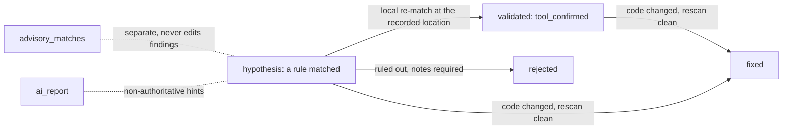

# Interpreting results

## Severity and confidence

- `severity` (`high`, `medium`, `low`; the schema also defines `critical`
  and `info`, but the current rules emit only `high` and `medium`): the impact if the finding is a real
  instance. Example: `tar-symlink-target-unchecked` is high, a
  `generic-credential` match is medium.
- `confidence` (`high`, `medium`, `low`): how sure the rule is that this is a
  real instance. Secret rules never report `high`; `generic-credential` is
  `low` because a quoted literal after a keyword is often not a secret.
- They are independent and are not probabilities. Triage by reading the
  location and evidence, not by the labels alone.

## Status and evidence

- `hypothesis`: a static rule matched. It may be a false positive.
- `validated` with method `tool_confirmed`: the validator re-read the file and
  the same pattern still matches at the recorded line and column. This is
  **not** exploit proof, and for secrets **not** proof the credential is live.
  Only secret findings are validated by the current CLI; vulnerability
  findings stay `hypothesis`. `--no-validate` keeps everything `hypothesis`.
- `rejected` and `fixed` are valid states in the
  [finding format](finding-format.md); a plain scan does not produce them.
- `evidence` items: `tool_output` (what the rule matched) and
  `code_snippet` (a redacted single line). Findings have no exploit
  reproduction.
- `advisory_matches` is a separate section. A `related_findings` entry is a
  deduplication hint, not proof that the finding is the advisory's issue.
- `ai_report` (only with `--ai-report`) is generated text, non-authoritative,
  and never changes findings or the exit code.

## Coverage: a clean result is not a safe result

Read `coverage` and `stats` on every run:

- `rules_run`: exactly 5 secret rules and 2 vulnerability rules.
- `files_seen` / `files_parsed` / `unsupported`: only Python is analysed by
  the vulnerability rules; other languages and unparseable Python are counted,
  not analysed.
- `detector_errors`, `detector_skipped`, `source_scan_caps_hit`: work that was
  cut short.
- `stats`: skipped files (binary, oversize, unreadable, secret-looking names)
  and cap flags. Skipped files are not scanned.

## Known limits

- Two vulnerability rules only; clean does not mean safe.
- Working tree only: no git history and no blob scanning.
- No temporary `ASIA` AWS keys.
- No dependency resolution: versions for advisory matching come only from
  `--package`.
- Intra-function analysis; guard heuristics are loose, so expect both false
  positives and false negatives ([detectors.md](detectors.md)).

## Handling potential secrets safely

1. Output is redacted (only text before the match is kept, followed by
   `[REDACTED]`), but redaction is best effort. Keep reports private.
2. For a real credential: rotate or revoke it at the issuer, then remove it
   from the code and history.
3. Never verify a credential against its provider, and do not add such a
   check to this tool; "validated" means a local pattern re-match only.
4. Do not commit report files that contain findings of a real repository.
   Write them outside the checkout or to an ignored path.
5. Use synthetic values in tests and docs, as `examples/` does.
