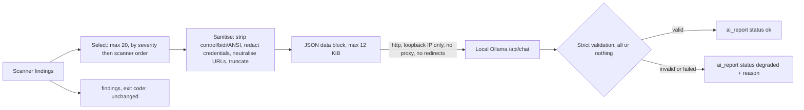

# Local-model report (`--ai-report`)

`security-reviewer review --ai-report` is an explicit opt-in. Without it the
tool is fully offline: no sockets are opened and output is byte-identical to
a run that never heard of this feature. With it, a bounded, sanitised summary
of the findings is sent to a model served **on this machine** (an Ollama
server on a loopback address), and its answer is added under a new top-level
`ai_report` key. Scanner findings stay authoritative; the model cannot add,
remove or re-rate anything, and the exit code depends only on the detectors
(`--fail-on-findings`), never on the model.

## Data flow



## What is sent / never sent

Sent (per selected finding, as fields of one JSON object in the user
message): finding id, rule, severity, confidence, status, path, start line
and the sanitised title plus up to three sanitised tool-output evidence
summaries (each at most 200 characters). The system prompt is fixed, states
that every field is untrusted data, and asks only for a short summary and a
high-level fix suggestion per id. The request also carries a JSON schema
(`format`), `stream:false`, `think:false`, `options` (`num_ctx`,
`num_predict`, `temperature:0`, `seed:0`) and no tools.

Never sent: file contents, `code_snippet` evidence (nor its caption),
patches, remediation text, absolute paths, or anything credential-like.
Sanitising strips control, bidi, zero-width and ANSI characters, collapses
whitespace, redacts the scanner's secret patterns, `key=value` credentials,
bearer tokens, URLs with userinfo and long token-like runs, replaces paths
with credential-looking segments by `[path redacted]`, and replaces URLs
with `[link removed]`. At most 20 findings are sent and the data block is at
most 12 KiB; the rest are counted in `ai_report.not_summarised`.

## Endpoint rules

`--ai-endpoint` must be `http://HOST[:PORT]` (optional trailing `/`) where
HOST is a literal loopback IP (`127.0.0.0/8`, `::1`) or the name
`localhost`. No DNS lookup is done: `localhost` is mapped to `127.0.0.1`.
Userinfo, query, fragment, other paths, other schemes, IP shorthand
(decimal/hex/octal/short forms) and IPv4-mapped IPv6 are refused with exit 2
before the scan output or any payload is produced. The client uses
`http.client` directly (proxy environment variables are ignored, no
redirects are followed, no cookies), checks that the connected peer is
loopback before sending anything, caps the response at 256 KiB and enforces
`--ai-timeout` as a hard wall-clock deadline for the whole model step.

## Local models only

Ollama can transparently forward some models ("cloud" models) to a remote
service, which would send the summary off the machine. Before any chat
request the client therefore calls `GET /api/tags` (same overall deadline),
requires the requested model to be listed, and refuses to send anything if
the entry has a non-empty `remote_host` or `remote_model`, or the name
contains `cloud` as a whole word (for example `-cloud`, `:cloud`). `--ai-model` values that look like cloud
models are a usage error (exit 2). Also disable cloud in the daemon itself,
for example by starting it with `OLLAMA_NO_CLOUD=1`. The digest is taken from
the same tags call.

Known limit (time-of-check/time-of-use): the tags check and the chat request
are separate HTTP requests, so a local process that can change the daemon's
models between them could swap the model. The loopback-only peer check and
`OLLAMA_NO_CLOUD=1` remain the primary controls; treat the daemon as trusted.

Payload size is budgeted against `--ai-num-ctx` (about 3 bytes per token for
prompt, schema and data, plus `--ai-max-tokens`); findings that do not fit
are dropped from the summary (counted in `not_summarised`).

## Options

| Option | Default |
| --- | --- |
| `--ai-report` | off (opt in) |
| `--ai-model NAME` | `qwen3:4b` |
| `--ai-endpoint URL` | `http://127.0.0.1:11434` |
| `--ai-timeout SECONDS` | `120` (positive number) |
| `--ai-num-ctx N` | `8192` |
| `--ai-max-tokens N` | `1024` |

Using any `--ai-*` option without `--ai-report` is a usage error (exit 2).

## Output

```json
"ai_report": {
  "status": "ok",
  "label": "AI-generated, non-authoritative; scanner findings are authoritative",
  "model": "qwen3:4b",
  "model_digest": "...",
  "not_summarised": 0,
  "items": [{"id": "<finding id>", "summary": "...", "fix_suggestion": "..."}]
}
```

`status` is one of `ok`, `degraded` or `no_findings` (no findings: the model
is not called and `items` is empty). `model_digest` appears only when
`GET /api/tags` reported it; failure there is ignored. `reason` appears only
when degraded; `items` is then empty.

| `reason` | Meaning |
| --- | --- |
| `endpoint_refused` | connection refused |
| `unavailable` | other connection/HTTP failure, or non-loopback peer |
| `timeout` | overall deadline reached |
| `bad_http_status` | any status other than 200 (all redirects included) |
| `malformed_output` | not strict JSON (duplicate keys, NaN), wrong shape, extra keys, truncated body, empty text |
| `unknown_ids` / `duplicate_ids` / `missing_ids` | ids not exactly the supplied set |
| `oversized_output` | response or text exceeds the caps (summary and fix 400 characters each) |
| `unsafe_output` | credential-like text, hostname-like or `//host` text, or text echoing something redacted from the input |
| `payload_empty` | no finding could be put in a payload |
| `context_too_small` | even one finding does not fit `--ai-num-ctx` together with the prompt, schema and `--ai-max-tokens` |
| `remote_model_refused` | the model is a remote/cloud model (see below); no chat request was sent |
| `model_unavailable` | the model is not listed by the server; no chat request was sent |

Validation is all or nothing: invalid content is never partially repaired.
Accepted text is further stripped of control/ANSI/bidi characters and
URLs and markdown links are neutralised. Model text appears only inside
`ai_report`.

## Install Ollama and pin a model

```
curl -fsSL https://ollama.com/install.sh | sh     # or your package manager
ollama serve                                      # listens on 127.0.0.1:11434
ollama pull qwen3:4b
ollama list                                       # note the digest
```

Record the digest from `ollama list` (or `ai_report.model_digest`) to pin the
exact weights used. No GPU is required: a 4B model runs on CPU, slowly
(expect tens of seconds); raise `--ai-timeout` as needed and keep
`--ai-num-ctx` small. Do not expose the Ollama port beyond loopback.

```
security-reviewer review PATH --ai-report --ai-model qwen3:4b
```
