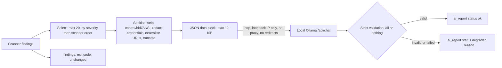
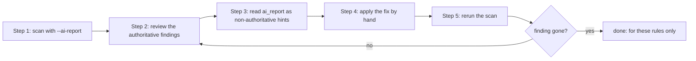

# Local-model report (`--ai-report`)

`security-reviewer review --ai-report` is an explicit opt-in. Without it the
tool is fully offline: no sockets are opened and output is byte-identical to
a run that never heard of this feature. With it, a bounded, sanitised summary
of the findings is sent to a model served **on this machine** (an Ollama
server on a loopback address), and its answer is added under a new top-level
`ai_report` key. Scanner findings stay authoritative; the model cannot add,
remove or re-rate anything, and the exit code depends only on the detectors
(`--fail-on-findings`), never on the model.

## Data flow



## What is sent / never sent

Sent (per selected finding, as fields of one JSON object in the user
message): finding id, rule, severity, confidence, status, path, start line
and the sanitised title plus up to three sanitised tool-output evidence
summaries (each at most 200 characters). The system prompt is fixed, states
that every field is untrusted data, and asks only for a short summary and a
high-level fix suggestion per id. The request also carries a JSON schema
(`format`), `stream:false`, `think:false`, `options` (`num_ctx`,
`num_predict`, `temperature:0`, `seed:0`) and no tools.

Never sent: file contents, `code_snippet` evidence (nor its caption),
patches, remediation text, absolute paths, or anything credential-like.
Sanitising strips control, bidi, zero-width and ANSI characters, collapses
whitespace, redacts the scanner's secret patterns, `key=value` credentials,
bearer tokens, URLs with userinfo and long token-like runs, replaces paths
with credential-looking segments by `[path redacted]`, and replaces URLs
with `[link removed]`. At most 20 findings are sent and the data block is at
most 12 KiB; the rest are counted in `ai_report.not_summarised`.

## Endpoint rules

`--ai-endpoint` must be `http://HOST[:PORT]` (optional trailing `/`) where
HOST is a literal loopback IP (`127.0.0.0/8`, `::1`) or the name
`localhost`. No DNS lookup is done: `localhost` is mapped to `127.0.0.1`.
Userinfo, query, fragment, other paths, other schemes, IP shorthand
(decimal/hex/octal/short forms) and IPv4-mapped IPv6 are refused with exit 2
before the scan output or any payload is produced. The client uses
`http.client` directly (proxy environment variables are ignored, no
redirects are followed, no cookies), checks that the connected peer is
loopback before sending anything, caps the response at 256 KiB and enforces
`--ai-timeout` as a hard wall-clock deadline for the whole model step.

## Local models only

Ollama can transparently forward some models ("cloud" models) to a remote
service, which would send the summary off the machine. Before any chat
request the client therefore calls `GET /api/tags` (same overall deadline),
requires the requested model to be listed, and refuses to send anything if
the entry has a non-empty `remote_host` or `remote_model`, or the name
contains `cloud` as a whole word (for example `-cloud`, `:cloud`). `--ai-model` values that look like cloud
models are a usage error (exit 2). Also disable cloud in the daemon itself,
for example by starting it with `OLLAMA_NO_CLOUD=1`. The digest is taken from
the same tags call.

Known limit (time-of-check/time-of-use): the tags check and the chat request
are separate HTTP requests, so a local process that can change the daemon's
models between them could swap the model. The loopback-only peer check and
`OLLAMA_NO_CLOUD=1` remain the primary controls; treat the daemon as trusted.

Payload size is budgeted against `--ai-num-ctx` (about 3 bytes per token for
prompt, schema and data, plus `--ai-max-tokens`); findings that do not fit
are dropped from the summary (counted in `not_summarised`).

## Options

| Option | Default |
| --- | --- |
| `--ai-report` | off (opt in) |
| `--ai-model NAME` | `qwen3:4b` |
| `--ai-endpoint URL` | `http://127.0.0.1:11434` |
| `--ai-timeout SECONDS` | `120` (positive number) |
| `--ai-num-ctx N` | `8192` |
| `--ai-max-tokens N` | `1024` |

Using any `--ai-*` option without `--ai-report` is a usage error (exit 2).

## Output

```json
"ai_report": {
  "status": "ok",
  "label": "AI-generated, non-authoritative; scanner findings are authoritative",
  "model": "qwen3:4b",
  "model_digest": "...",
  "not_summarised": 0,
  "items": [{"id": "<finding id>", "summary": "...", "fix_suggestion": "..."}]
}
```

`status` is one of `ok`, `degraded` or `no_findings` (no findings: the model
is not called and `items` is empty). `model_digest` appears only when
`GET /api/tags` reported it; failure there is ignored. `reason` appears only
when degraded; `items` is then empty.

| `reason` | Meaning |
| --- | --- |
| `endpoint_refused` | connection refused |
| `unavailable` | other connection/HTTP failure, or non-loopback peer |
| `timeout` | overall deadline reached |
| `bad_http_status` | any status other than 200 (all redirects included) |
| `malformed_output` | not strict JSON (duplicate keys, NaN), wrong shape, extra keys, truncated body, empty text |
| `unknown_ids` / `duplicate_ids` / `missing_ids` | ids not exactly the supplied set |
| `oversized_output` | response or text exceeds the caps (summary and fix 400 characters each) |
| `unsafe_output` | credential-like text, hostname-like or `//host` text, or text echoing something redacted from the input |
| `payload_empty` | no finding could be put in a payload |
| `context_too_small` | even one finding does not fit `--ai-num-ctx` together with the prompt, schema and `--ai-max-tokens` |
| `remote_model_refused` | the model is a remote/cloud model (see below); no chat request was sent |
| `model_unavailable` | the model is not listed by the server; no chat request was sent |

Validation is all or nothing: invalid content is never partially repaired.
Accepted text is further stripped of control/ANSI/bidi characters and
URLs and markdown links are neutralised. Model text appears only inside
`ai_report`.

## Install Ollama and pin a model

```
curl -fsSL https://ollama.com/install.sh | sh     # or your package manager
OLLAMA_NO_CLOUD=1 ollama serve                    # listens on 127.0.0.1:11434
ollama pull qwen3:4b
ollama list                                       # note the digest
```

If `ollama serve` is already running as a systemd service (the install script
sets one up), the `OLLAMA_NO_CLOUD=1` shown above does not reach it; run
`sudo systemctl edit ollama` and add `Environment="OLLAMA_NO_CLOUD=1"` under
`[Service]`, then `sudo systemctl restart ollama`.

Record the digest from `ollama list` (or `ai_report.model_digest`) to pin the
exact weights used. No GPU is required: a 4B model runs on CPU, slowly
(expect tens of seconds); raise `--ai-timeout` as needed and keep
`--ai-num-ctx` small. Do not expose the Ollama port beyond loopback.

```
security-reviewer review PATH --ai-report --ai-model qwen3:4b
```

## Ollama setup, step by step

1. Install Ollama (see above) and start the daemon with cloud disabled:

   ```
   OLLAMA_NO_CLOUD=1 ollama serve
   ```

   `OLLAMA_NO_CLOUD=1` must be set in the environment of the **daemon**
   (for a systemd service, in its unit environment), not of the
   `security-reviewer` process. It disables Ollama cloud models; see Ollama's
   documentation for the exact guarantee.
2. `ollama pull qwen3:4b` and note the digest with `ollama list`.
3. Run the review with the opt-in flag:

   ```
   security-reviewer review PATH --ai-report --ai-timeout 120 --ai-num-ctx 4096
   ```

Defence in depth: independently of the daemon setting, the client refuses to
send anything when `GET /api/tags` shows the model has a `remote_host` or
`remote_model`, or when the model name looks like a cloud model, and it only
connects to loopback (see "Local models only" and "Endpoint rules" above).

## Model tested on CPU

Smoke test of 2026-11-10 (one finding, one run):

| Item | Value |
| --- | --- |
| Ollama client/server | 0.40.16 |
| Model | `qwen3:4b`, Q4_K_M |
| Digest | `359d7dd4bcdab3d86b87d73ac27966f4dbb9f5efdfcc75d34a8764a09474fae7` |
| Hardware | CPU only, 4 vCPU, 7.7 GB RAM |
| Settings | `--ai-num-ctx 4096` |
| Result | cold end-to-end about 26 s on a single-finding report |

This was a smoke test, not a quality benchmark. Expect other models, hardware
and larger reports to differ, and raise `--ai-timeout` accordingly.

Rerun of 2026-11-24 against commit `f56d1a6`, the tested source commit (later
commits only change documentation and tests):

| Item | Value |
| --- | --- |
| Ollama | 0.40.16, `library=cpu`, no GPU |
| Model | `qwen3:4b`, Q4_K_M |
| Digest | `359d7dd4bcdab3d86b87d73ac27966f4dbb9f5efdfcc75d34a8764a09474fae7` |
| Hardware | CPU only, 4 vCPU, 7.6 GiB RAM |
| Daemon | `127.0.0.1:11434`, `OLLAMA_NO_CLOUD=1` |
| Settings | `--ai-num-ctx 4096`, `--ai-timeout 600` |
| Input | `examples/demo` with 3 findings |
| Result | cold run about 61 s, warm run about 27 s |
| Report | `status` ok, 0 `not_summarised` |

Exact commands (start the daemon with cloud disabled, then run the review; if
a systemd daemon already owns the port, skip the `serve` line and follow the
systemd note above instead):

```
OLLAMA_NO_CLOUD=1 OLLAMA_HOST=127.0.0.1:11434 ollama serve &
security-reviewer review examples/demo \
  --advisories examples/demo/advisories.json \
  --ai-report --ai-model qwen3:4b --ai-num-ctx 4096 --ai-timeout 600
```

The captured sample is
[examples/expected/review-ai-qwen3-4b.json](../examples/expected/review-ai-qwen3-4b.json).
It is one non-deterministic sample, not a benchmark: another run can word the
items differently. The scanner verdicts stay authoritative, and the tests
check only that the scanner part of the sample matches the scanner output,
that item ids are unique and belong to real findings, and that the sample
contains no home or temp paths, checkout root, demo secret value or
credential-like token.

## Report and suggested-fix workflow



The tool never edits your code. The findings (with their evidence and
remediation text) are the source of truth; the model's `fix_suggestion` is a
hint to read after you have understood the finding. Rerun the scan after the
change; the exit code and findings come from the detectors only.

## Example `ai_report`

Shape of the single-finding `qwen3:4b` output, with a synthetic finding id
(the digest line is the pinned model above):

```json
"ai_report": {
  "items": [
    {
      "fix_suggestion": "Remove hardcoded AWS access key ID from source code",
      "id": "secret.aws-access-key-id.0123456789abcdef",
      "summary": "Hardcoded AWS access key ID detected in source code"
    }
  ],
  "label": "AI-generated, non-authoritative; scanner findings are authoritative",
  "model": "qwen3:4b",
  "model_digest": "359d7dd4bcdab3d86b87d73ac27966f4dbb9f5efdfcc75d34a8764a09474fae7",
  "not_summarised": 0,
  "status": "ok"
}
```

## Interpreting model output

- `status: ok`: the answer passed strict validation. It is still generated
  text. `status: degraded` plus a `reason` (table above) means no usable
  summary; the scan result is unaffected. `no_findings`: the model was not
  called.
- Summaries can be wrong, generic or incomplete: the example above merely
  restates the rule and gives no instruction about rotating the key. Do not
  rely on it for triage, severity or whether a secret is live.
- The model cannot add, remove, re-rate or validate findings, and it never
  changes the exit code.
- Rotate real credentials regardless of what the model says.

## Data flow to the model provider

Nothing leaves the loopback interface from this tool's client. The client connects only to a literal
loopback address (or `localhost` mapped to `127.0.0.1`), ignores proxy
settings, follows no redirects and checks that the connected peer is
loopback. The only data sent is the sanitised, bounded summary described in
"What is sent / never sent": never file contents, code snippets, absolute
paths or credential-like text (best effort: the sanitiser redacts known
secret patterns, see above). Ollama itself runs on your machine and, with
`OLLAMA_NO_CLOUD=1` and a locally pulled model, makes no inference call to a
remote provider. Without `--ai-report` no socket is opened at all.
