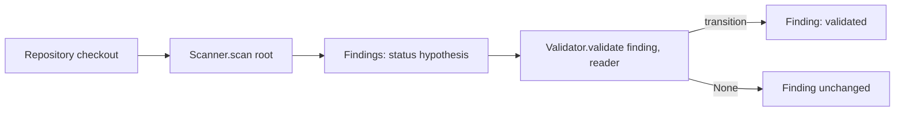

# Scanner and Validator interfaces

Two small `typing.Protocol`s (both `runtime_checkable`) in
`security_reviewer.interfaces`. They import nothing from GitHub or any model
provider, so static tools, AI models and human tooling can all implement them.



## Interfaces

```python
class Scanner(Protocol):
    def scan(self, root) -> Iterable[Finding]: ...

class Validator(Protocol):
    def validate(self, finding: Finding, reader: ContextReader) -> Finding | None: ...
```

- `Scanner.scan(root)` takes a directory path and yields schema_version 1
  findings in a deterministic order.
- `ContextReader` is a callable `reader(repo_relative_posix_path) -> str | None`
  (None when the file is unavailable).
- `Validator.validate` returns a new `Finding` obtained through
  `Finding.transition(...)`, or `None` when nothing changes or the finding is
  not handled by that validator.

## SecretScanner

Local, stdlib-only. Emits `origin=static_tool`, `status=hypothesis`,
`cwe=CWE-798`, category `hardcoded-secret`, never `confidence=high`.
Finding ids are `secret.<rule>.<hash16>` where the hash covers rule, path,
line and column, never the secret value.

Redaction is conservative. The code snippet keeps only the text *before* the
first match on the line, followed by `[REDACTED]`; nothing after a match is
kept, and any run of 12 or more characters from `[A-Za-z0-9+/=_-]` in that
prefix is also masked. The `private-key` rule emits no snippet at all. File
and directory names that match a secret rule are never reported (see below),
so the secret value should appear in no finding field. This is best-effort
pattern redaction: a secret in a format no rule recognises and shorter than
12 characters in the prefix can still be shown.

| Rule id | Detects | Severity | Confidence |
| --- | --- | --- | --- |
| `aws-access-key-id` | `AKIA` + 16 upper-case alphanumerics | high | medium |
| `private-key` | PEM `-----BEGIN ... PRIVATE KEY-----` header | high | medium |
| `github-token` | `ghp_`/`gho_`/`ghu_`/`ghs_`/`ghr_` and `github_pat_` tokens | high | medium |
| `slack-token` | `xoxa-`/`xoxb-`/`xoxp-`/`xoxr-`/`xoxs-` tokens | high | medium |
| `generic-credential` | `password`, `passwd`, `secret`, `api_key`, `access_token` assigned a quoted literal of 8+ characters; obvious placeholders (`changeme`, `example`, `<...>`, `${...}`, repeated characters) are ignored | medium | low |

### Untrusted content and limits

Scanned files are data. They are never imported or executed, are read as bytes
and decoded with `errors="replace"`.

- Symlinks (files and directories) are skipped. The tree is walked with
  `os.fwalk(follow_symlinks=False)`; each entry is `lstat`ed relative to its
  directory descriptor and only regular files are opened (with `dir_fd`,
  `O_NOFOLLOW|O_NONBLOCK`, then re-checked with `fstat`). Devices, FIFOs and
  sockets are never opened. This closes the usual symlink-swap races for
  everything below `root`; `root` itself is opened as given, so pass a
  trusted path. An attacker able to rename parent directories above `root`
  during a scan is out of scope.
- Skipped directories: `.git`, `node_modules`, `vendor`, `.venv`, `venv`,
  `__pycache__` and similar (`skip_dirs`).
- Files containing NUL bytes are skipped as binary.
- Paths that fail the finding format's Location rules (control or bidi
  characters, backslash, invalid UTF-8, too long, NUL) are skipped, not fatal.
- Files or directories whose name matches a secret rule are skipped
  (`skipped_secret_in_path`) so the secret is not leaked via `Location.path`.
- Unreadable files are skipped.
- Skips are visible: `scanner.stats` has a counter per reason plus
  `skip_samples`, a list of at most 50 `(reason, path)` pairs. The path is
  `ascii()`-escaped and truncated, and is `None` when it looks like a secret.

### Generic rule keywords

`generic-credential` matches (case-insensitive) `password`, `passwd`, `pwd`,
`secret`, `secret_key`, `secret_access_key`, `api_key`, `access_token`,
`auth_token` and `private_key` (`_`/`-` interchangeable where shown, including
`client_secret` and `aws_secret_access_key` via the `secret` forms), then `:`
or `=`, then a quoted literal of 8 to 200 non-space, non-quote characters.
A value is ignored only if the *whole* value is a placeholder: `<...>`,
`${...}`, `{{...}}`, `%...%`, `$VAR`, a run of `x`/`*`/`#`, a repeated single
character, or only placeholder words such as `changeme`, `example`,
`your-api-key-here`. Values that merely contain such words (for example
`Zx9!realSecretValue42`) are reported. The matched value is always redacted.

| Constructor parameter | Default |
| --- | --- |
| `max_file_size` | 1 MiB (larger files skipped) |
| `max_files` | 10000 |
| `max_total_bytes` | 64 MiB |
| `max_findings` | 1000 |
| `max_line_length` | 2000 (longer lines are truncated before matching) |
| `max_entries` | 200000 (every directory and file entry visited, including skipped ones) |

After a scan, `scanner.stats` (`ScanStats`) reports counts of scanned and
skipped files and which caps were hit.

## SecretValidator

A deterministic `Validator`: re-reads the recorded line through the
`ContextReader`, and if the rule still matches at the recorded column it
returns the finding transitioned `hypothesis -> validated` with
`ValidationMethod.TOOL_CONFIRMED`. This confirms the pattern is present, not
that the credential is live. Otherwise it returns `None`.
`LocalContextReader(root)` opens each directory component with
`O_DIRECTORY|O_NOFOLLOW` relative to its parent descriptor and the file as the
scanner does, and returns `None` for invalid paths, symlinks, special files
or read errors.

## Running

```python
from security_reviewer import SecretScanner, SecretValidator, LocalContextReader

root = "path/to/checkout"
reader = LocalContextReader(root)
for f in SecretScanner().scan(root):
    f = SecretValidator().validate(f, reader) or f
    print(f.to_json())
```

Tests: `python3 -m unittest discover -s tests -v`.
