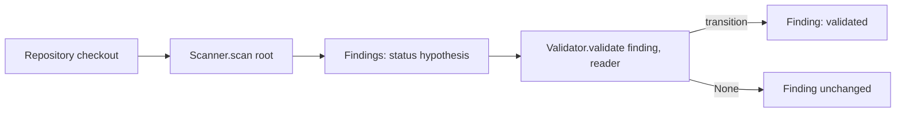

# Scanner and Validator interfaces

Two small `typing.Protocol`s (both `runtime_checkable`) in
`security_reviewer.interfaces`. They import nothing from GitHub or any model
provider, so static tools, AI models and human tooling can all implement them.



## Interfaces

```python
class Scanner(Protocol):
    def scan(self, root) -> Iterable[Finding]: ...

class Validator(Protocol):
    def validate(self, finding: Finding, reader: ContextReader) -> Finding | None: ...
```

- `Scanner.scan(root)` takes a directory path and yields schema_version 1
  findings in a deterministic order.
- `ContextReader` is a callable `reader(repo_relative_posix_path) -> str | None`
  (None when the file is unavailable).
- `Validator.validate` returns a new `Finding` obtained through
  `Finding.transition(...)`, or `None` when nothing changes or the finding is
  not handled by that validator.

## SecretScanner

Local, stdlib-only. Emits `origin=static_tool`, `status=hypothesis`,
`cwe=CWE-798`, category `hardcoded-secret`, never `confidence=high`.
Finding ids are `secret.<rule>.<hash16>` where the hash covers rule, path,
line and column, never the secret value.

Redaction is conservative. The code snippet keeps only the text *before* the
first match on the line, followed by `[REDACTED]`; nothing after a match is
kept, and any run of 12 or more non-space characters in that prefix is
also masked. The `private-key` rule emits no snippet at all. File
and directory names that match a secret rule are never reported (see below),
so the secret value should appear in no finding field. This is best-effort
pattern redaction: a secret in a format no rule recognises and shorter than
12 characters, placed before the first match, can still be shown.

| Rule id | Detects | Severity | Confidence |
| --- | --- | --- | --- |
| `aws-access-key-id` | `AKIA` + 16 upper-case alphanumerics | high | medium |
| `private-key` | PEM `-----BEGIN ... PRIVATE KEY-----` header | high | medium |
| `github-token` | `ghp_`/`gho_`/`ghu_`/`ghs_`/`ghr_` and `github_pat_` tokens | high | medium |
| `slack-token` | `xoxa-`/`xoxb-`/`xoxp-`/`xoxr-`/`xoxs-` tokens | high | medium |
| `generic-credential` | a credential keyword (see below) assigned a quoted literal of 8+ characters; whole-value placeholders (see below) are ignored | medium | low |

### Untrusted content and limits

Scanned files are data. They are never imported or executed, are read as bytes
and decoded with `errors="replace"`.

- Symlinks (files and directories) are skipped. The walker is iterative: it
  opens `root` with `O_RDONLY|O_DIRECTORY|O_CLOEXEC`, lists each directory
  with `os.listdir(fd)`, classifies every entry with `lstat` relative to that
  directory descriptor, and opens each subdirectory with
  `O_RDONLY|O_DIRECTORY|O_NOFOLLOW|O_CLOEXEC` relative to its parent
  descriptor. Only regular files are opened (with `dir_fd`,
  `O_NOFOLLOW|O_NONBLOCK`, then re-checked with `fstat`). Devices, FIFOs and
  sockets are never opened. This closes the usual symlink-swap races for
  everything below `root`; `root` itself is opened as given, so pass a
  trusted path. An attacker able to rename parent directories above `root`
  during a scan is out of scope. Descriptors are closed promptly, including
  when a cap ends the scan early.
- Skipped directories: `.git`, `node_modules`, `vendor`, `.venv`, `venv`,
  `__pycache__` and similar (`skip_dirs`).
- Files containing NUL bytes are skipped as binary.
- Paths that fail the finding format's Location rules (control or bidi
  characters, backslash, invalid UTF-8, too long, NUL) are skipped, not fatal.
- Files or directories whose name matches a secret rule are skipped
  (`skipped_secret_in_path`) so the secret is not leaked via `Location.path`.
- Unreadable files are skipped.
- Directory depth is capped by `max_depth` (default 64). The walker is
  iterative and holds at most `max_depth + 1` open directory descriptors, so a
  deeply nested tree cannot exhaust descriptors or the recursion limit.
  Directories deeper than the cap are not scanned: they are counted in
  `skipped_too_deep`, `hit_depth_cap` is set and a skip sample is recorded.
- Secret-in-name detection uses separate, unanchored patterns applied to the
  joined relative path and to every path component (so a value split across
  directory and file name, like `password=/Hunter2Hunter2`, is caught), so tokens glued to other characters (`backup_ghp_<token>.txt`)
  are still caught.
- **Skipped files are NOT scanned.** Files with bad or secret-bearing names,
  files under too-deep or skipped directories, oversize, binary, special and
  unreadable files produce no findings; they appear only in `scanner.stats`
  counters and `skip_samples`. A clean result therefore means "no matches in
  what was scanned"; check `stats` for skips and cap flags.
- Skips are visible: `scanner.stats` has a counter per reason plus
  `skip_samples`, a list of at most 50 `(reason, path)` pairs. The path is
  `ascii()`-escaped and truncated, and is `None` when it looks like a secret.

### Generic rule keywords

`generic-credential` matches (case-insensitive) the keywords `password`,
`passwd`, `pwd`, `secret`, `secret_key`, `secret_access_key`, `api_key`,
`access_token`, `auth_token` and `private_key` (`_` or `-` or nothing between
the words where shown; `client_secret` and `aws_secret_access_key` match via
the `secret` forms), then `:` or `=`, then a quoted literal of 8 to 200
non-space, non-quote characters. The same keyword list is used for the
secret-in-file-name check (one shared constant).

A value is ignored only if the whole value is a placeholder. The exact shapes
are: `<name>`, `${NAME}`, `{{name}}`, `%NAME%` (identifier-like contents
only), `%(name)s` (printf-style format placeholder, `s`, `d` or `r`), `$VAR` with an all-upper-case env-style name (so all-uppercase `$VAR`
values are treated as placeholders and not reported, while `$uperS3cret` is
reported), a value made only of `x`, `X`, `*`, `#`, `.`, `_` or `-`
characters, a single repeated character, or only placeholder words such as
`changeme`, `example`, `your-api-key-here` (joined by `_`, `-` or `.`). Values
that merely contain such words (for example `Zx9!realSecretValue42`) are
reported. The matched value is always redacted.

| Constructor parameter | Default |
| --- | --- |
| `max_file_size` | 1 MiB (larger files skipped) |
| `max_files` | 10000 |
| `max_total_bytes` | 64 MiB |
| `max_findings` | 1000 |
| `max_line_length` | 2000 (longer lines are truncated before matching) |
| `max_depth` | 64 (deeper directories are not scanned) |
| `max_entries` | 200000 (every directory and file entry visited, including skipped ones) |

After a scan, `scanner.stats` (`ScanStats`) reports counts of scanned and
skipped files and which caps were hit.

## SecretValidator

A deterministic `Validator`: re-reads the recorded line through the
`ContextReader`, and if the rule still matches at the recorded column it
returns the finding transitioned `hypothesis -> validated` with
`ValidationMethod.TOOL_CONFIRMED`. This confirms the pattern is present, not
that the credential is live. Otherwise it returns `None`, including when the
reader raises.
`LocalContextReader(root)` opens each directory component with
`O_DIRECTORY|O_NOFOLLOW` relative to its parent descriptor and the file as the
scanner does, and returns `None` for invalid paths, symlinks, special files
or read errors.

## Running

```python
from security_reviewer import SecretScanner, SecretValidator, LocalContextReader

root = "path/to/checkout"
reader = LocalContextReader(root)
for f in SecretScanner().scan(root):
    f = SecretValidator().validate(f, reader) or f
    print(f.to_json())
```

Tests: `python3 -m unittest discover -s tests -v`.
