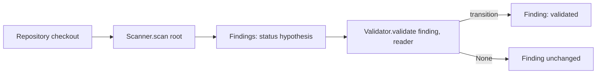

# Scanner and Validator interfaces

Two small `typing.Protocol`s (both `runtime_checkable`) in
`security_reviewer.interfaces`. They import nothing from GitHub or any model
provider, so static tools, AI models and human tooling can all implement them.



## Interfaces

```python
class Scanner(Protocol):
    def scan(self, root) -> Iterable[Finding]: ...

class Validator(Protocol):
    def validate(self, finding: Finding, reader: ContextReader) -> Finding | None: ...
```

- `Scanner.scan(root)` takes a directory path and yields schema_version 1
  findings in a deterministic order.
- `ContextReader` is a callable `reader(repo_relative_posix_path) -> str | None`
  (None when the file is unavailable).
- `Validator.validate` returns a new `Finding` obtained through
  `Finding.transition(...)`, or `None` when nothing changes or the finding is
  not handled by that validator.

## SecretScanner

Local, stdlib-only. Emits `origin=static_tool`, `status=hypothesis`,
`cwe=CWE-798`, category `hardcoded-secret`, never `confidence=high`.
Finding ids are `secret.<rule>.<hash16>` where the hash covers rule, path,
line and column, never the secret value. Evidence holds a snippet with every
matched secret replaced by `[REDACTED]`; the value appears in no field.

| Rule id | Detects | Severity | Confidence |
| --- | --- | --- | --- |
| `aws-access-key-id` | `AKIA` + 16 upper-case alphanumerics | high | medium |
| `private-key` | PEM `-----BEGIN ... PRIVATE KEY-----` header | high | medium |
| `github-token` | `ghp_`/`gho_`/`ghu_`/`ghs_`/`ghr_` and `github_pat_` tokens | high | medium |
| `slack-token` | `xoxa-`/`xoxb-`/`xoxp-`/`xoxr-`/`xoxs-` tokens | high | medium |
| `generic-credential` | `password`, `passwd`, `secret`, `api_key`, `access_token` assigned a quoted literal of 8+ characters; obvious placeholders (`changeme`, `example`, `<...>`, `${...}`, repeated characters) are ignored | medium | low |

### Untrusted content and limits

Scanned files are data. They are never imported or executed, are read as bytes
and decoded with `errors="replace"`.

- Symlinks (files and directories) are skipped; files are opened with
  `O_NOFOLLOW` and only regular files are read, so nothing outside `root`
  is read.
- Skipped directories: `.git`, `node_modules`, `vendor`, `.venv`, `venv`,
  `__pycache__` and similar (`skip_dirs`).
- Files containing NUL bytes are skipped as binary.
- Paths that fail the finding format's Location rules (control or bidi
  characters, backslash, invalid UTF-8, too long) are skipped, not fatal.
- Unreadable files are skipped.

| Constructor parameter | Default |
| --- | --- |
| `max_file_size` | 1 MiB (larger files skipped) |
| `max_files` | 10000 |
| `max_total_bytes` | 64 MiB |
| `max_findings` | 1000 |
| `max_line_length` | 2000 (longer lines are truncated before matching) |

After a scan, `scanner.stats` (`ScanStats`) reports counts of scanned and
skipped files and which caps were hit.

## SecretValidator

A deterministic `Validator`: re-reads the recorded line through the
`ContextReader`, and if the rule still matches at the recorded column it
returns the finding transitioned `hypothesis -> validated` with
`ValidationMethod.TOOL_CONFIRMED`. This confirms the pattern is present, not
that the credential is live. Otherwise it returns `None`.
`LocalContextReader(root)` is a safe reader (no symlinks, no escaping `root`).

## Running

```python
from security_reviewer import SecretScanner, SecretValidator, LocalContextReader

root = "path/to/checkout"
reader = LocalContextReader(root)
for f in SecretScanner().scan(root):
    f = SecretValidator().validate(f, reader) or f
    print(f.to_json())
```

Tests: `python3 -m unittest discover -s tests -v`.
